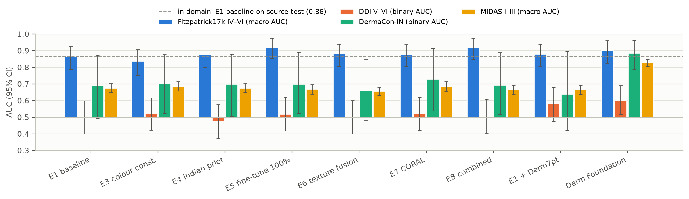

# Mid-semester review pack

Domain-adaptive skin cancer classification (FST I–III → IV–VI and Indian data). Team: Ankita Vemavarapu, Aeleni Deepak Reddy, Ranganaini Sai Ruchir. Supervisor: Dr. Anjli Varghese; co-supervisor: Venkatasubramanian K. Status as of 17 Oct 2026: the data are frozen and E1–E8 are complete on the full Fitzpatrick17k set.

This pack covers what the review asks for: data, splits, E1–E3 with confidence intervals, the gap figure and Grad-CAM. Full results are in [RESULTS.md](RESULTS.md), and the plain-language walkthrough is [PROJECT_EXPLAINER.pdf](PROJECT_EXPLAINER.pdf).

## 1. Data

| Dataset | Role | Used images |
| --- | --- | --- |
| Fitzpatrick17k (full set from the authors, D21) | Train FST I–III; target train/val/test FST IV–VI | 1,741 source (FST I–III) + 429 target (FST IV–VI) |
| PAD-UFES-20 (Brazil, smartphone, biopsy-proven) | Train FST I–III; FST IV–VI test only | 1,151 source (FST I–III); 60 FST IV–VI test |
| DDI (Stanford, biopsy-proven, all FST) | Test only, the headline set; never shown in figures | 656 |
| DermaCon-IN (India) | Test only | 65 tumours + lookalikes; 5,379 other conditions |
| MRA-MIDAS (Stanford, mostly FST I–III) | Test only: new hospital, same skin tones | 1,380 |
| Derm7pt (Italy) | Training-only extra data, one arm (D16) | 954 |

Pipeline: label map (460 diagnosis names → BCC / SCC / melanoma / benign / AK / exclude) → manifest → de-duplication (pHash ≤ 2 or embedding cosine ≥ 0.90, plus patient ID) → grouped splits → class-count check. All outputs are committed and frozen.
- **Label map:** a second full review on 17 Oct found one 1-image error with no effect on any score. It is ready for team sign-off; see [LABEL_MAP_REVIEW.md](LABEL_MAP_REVIEW.md).
- **AK:** a pre-cancer, so it is never trained on. It is scored separately (311 images).

## 2. Splits

| Split | Images | BCC | SCC | Melanoma | Benign |
| --- | --- | --- | --- | --- | --- |
| Source train (FST I–III) | 2,022 | 902 | 400 | 337 | 383 |
| Source val | 435 | 194 | 86 | 72 | 83 |
| Source test | 435 | 194 | 86 | 73 | 82 |
| Target train (FST IV–VI) | 257 | 65 | 70 | 61 | 61 |
| Target val | 86 | 22 | 24 | 20 | 20 |
| Target test | 86 | 22 | 23 | 21 | 20 |

- Source is split 70/15/15 and target 60/20/20.
- No duplicate group crosses splits; the code asserts it.
- The target test set has 23 SCC images, above the 15 threshold, so four classes are kept (D6).
- Source val selects checkpoints; target val selects between methods. Test sets choose nothing, and the external sets are scored once each through a ledger.

## 3. E1–E3 with 95% CIs

Means of 3 seeds, group-bootstrap CIs. Macro AUC for the Fitzpatrick17k sets; binary AUC (cancer vs not) for the external sets.

| Method | Target val | Source test | Target test | DDI FST I–II | DDI FST V–VI | DermaCon-IN | MIDAS FST I–III |
| --- | --- | --- | --- | --- | --- | --- | --- |
| E1 EfficientNet-B0 | 0.92 [0.87, 0.96] | 0.89 [0.87, 0.92] | 0.89 [0.84, 0.94] | 0.65 [0.56, 0.73] | **0.53 [0.43, 0.62]** | 0.71 [0.52, 0.87] | 0.69 [0.65, 0.72] |
| E2 ResNet50 | 0.81 [0.73, 0.87] | 0.79 [0.76, 0.82] | 0.79 [0.72, 0.86] | 0.75 [0.66, 0.83] | 0.58 [0.48, 0.67] | 0.76 [0.56, 0.94] | 0.64 [0.61, 0.68] |
| E3 colour constancy | 0.92 [0.87, 0.96] | 0.88 [0.86, 0.91] | 0.89 [0.84, 0.94] | 0.63 [0.54, 0.71] | 0.52 [0.42, 0.62] | 0.72 [0.53, 0.88] | 0.68 [0.64, 0.71] |
| E3 CLAHE | 0.90 [0.84, 0.94] | 0.88 [0.85, 0.90] | 0.88 [0.83, 0.93] | 0.66 [0.56, 0.74] | 0.55 [0.46, 0.64] | 0.71 [0.51, 0.89] | 0.70 [0.67, 0.73] |
| E3 lesion crop | 0.90 [0.85, 0.94] | 0.88 [0.86, 0.91] | 0.87 [0.81, 0.92] | 0.61 [0.52, 0.70] | 0.53 [0.42, 0.62] | 0.62 [0.46, 0.80] | 0.66 [0.63, 0.70] |
| E3 all three | 0.90 [0.85, 0.94] | 0.87 [0.85, 0.90] | 0.86 [0.81, 0.92] | 0.62 [0.52, 0.71] | 0.50 [0.41, 0.59] | 0.73 [0.57, 0.90] | 0.68 [0.65, 0.71] |

**Findings so far:**
- **No skin-tone gap inside Fitzpatrick17k** (0.89 vs 0.89), because its dark-skin photos come from the same atlases.
- **A large gap at an outside hospital.** DDI V–VI is at chance (0.53), and at a cut-off that catches 90% of cancers at home the model misses 36% of DDI V–VI cancers, against 9% for DDI I–II.
- **The gap is partly the hospital.** MIDAS, with mostly light skin, already drops to 0.69.
- **Image processing (E3) does not help.** No variant beats E1 on target val (D22). The crop hurts on clinic photos; by eye, about 15–20% of 100 crops miss the lesion.

## 4. Gap figure

Every method from E1 to E8 plus the stronger baselines, on four test sets. The dashed line is E1 at home, and 0.5 is chance. The one method that lifts every outside set is Derm Foundation (DDI V–VI 0.61, DermaCon-IN 0.86, MIDAS 0.82).

## 5. Grad-CAM

Grids of 20 correct and 20 wrong predictions on source test and target test (E1) and on target test (E7 CORAL). They contain patient photos, so they stay local: `python -m skincancer.analysis.gradcam --run runs/e1_effb0/s0 --split target_test --n 20`.
- **Correct predictions:** E1 looks at the lesion in about 37 of 40.
- **Wrong predictions:** about two-thirds still look at the lesion, so the model sees it but misjudges it. One-third look at borders, background, a colour bar, a ruler or an atlas censor bar.
- **CORAL:** its maps more often spread to the surrounding skin or image edges, even when correct.

## 6. What comes next

- **Team sign-off:** the label map ([LABEL_MAP_REVIEW.md](LABEL_MAP_REVIEW.md)).
- **Results:** already complete for E4–E8 and the stronger baselines (RESULTS.md).
- **Report and presentation:** the IEEE-format report and the 15-minute presentation.
- **Time limit:** DDI access expires on 12 Nov 2026. Any further DDI scoring must happen before then.
